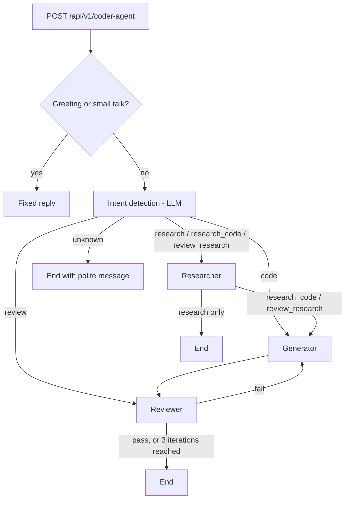

# Multi-Agent Coding Assistant (MCP Client)

A FastAPI service that answers coding questions with three cooperating LLM agents: a **researcher**, a **code generator** and a **code reviewer**. The agents are orchestrated with LangGraph, call tools on external MCP servers, and use AWS Bedrock as the LLM. Conversation state is stored in PostgreSQL.

## What it does

Send one message to a single endpoint. The service works out what you want and runs the right agents:

| You ask for | Intent | What runs |
|---|---|---|
| "Write a binary search" | `code` | Generator, then Reviewer (loops until pass) |
| "Review this code: ..." | `review` | Reviewer, then Generator fixes it if the review fails |
| "Am I using LangChain correctly?" | `review_research` | Researcher, then Generator, then Reviewer |
| "What is multithreading?" | `research` | Researcher only |
| "Explain caching and give code" | `research_code` | Researcher, then Generator, then Reviewer |
| Anything unrelated | `unknown` | Stops and replies that it only helps with coding tasks |

Greetings ("hi") and small talk ("how are you") get a fixed reply without calling the LLM.

## How it works



- The **researcher** uses a DuckDuckGo search MCP server.
- The **reviewer** uses the MCP Python Toolbox server (linting, formatting, code execution). The LLM decides whether to call these tools.
- The **generator** uses only the LLM (no tools). It receives the research output and the reviewer's notes when available.
- The review loop runs at most **3 iterations** (`MAX_ITERATIONS` in `services/coder_agent_service.py`).
- Each user is a LangGraph thread (`thread_id = user_id`), and checkpoints are saved in PostgreSQL.

## Project structure

```
.
├── src/
│   ├── app.py                   # FastAPI app, CORS, exception handlers
│   ├── setting.py               # Config loaded from environment
│   ├── routes/coder_agent_router.py
│   ├── services/coder_agent_service.py   # LangGraph flow and intent routing
│   ├── agents/                  # generator, researcher, reviewer agents and their prompts
│   ├── dependency/dependency.py # FastAPI dependency injection
│   ├── models/                  # request/response DTOs, API response, custom exception
│   └── utils/                   # Bedrock client, LLM client, logger, error helpers
├── .gitignore
├── .python-version
├── pyproject.toml
├── README.md
└── uv.lock
```

## Requirements

- Python 3.14 (see `pyproject.toml` and `.python-version`)
- [uv](https://docs.astral.sh/uv/) (or pip)
- PostgreSQL
- AWS account with **Amazon Bedrock** model access and your own credentials
- The two external MCP servers below, running locally

## External MCP servers (not included in this repo)

Start both before calling the API. If either is down, the agent that needs it fails and the request returns a 500.

### Reviewer server: MCP Python Toolbox

- Source: https://github.com/gianlucamazza/mcp_python_toolbox (by Gianluca Mazza)
- The API expects it at `http://127.0.0.1:8002/sse` (SSE transport).

```bash
git clone https://github.com/gianlucamazza/mcp_python_toolbox.git
cd mcp_python_toolbox
pip install -e .
mkdir workspace
python -m mcp_python_toolbox --workspace ./workspace
```

The server must run on **port 8002 with SSE transport**. If the upstream version starts differently, set `server.settings.port = 8002` and `server.run(transport="sse")` in its `__main__.py`.

Keep `--workspace` pointed at an empty folder (`./workspace` above): the toolbox can execute Python code and install packages there. The reviewer blocks the file tools (`read_file`, `write_file`, `create_file`, `delete_file`, `analyze_python_file`) by default; see `BLOCKED_TOOLS` below.

### Researcher server: DuckDuckGo search

- Source: https://github.com/nickclyde/duckduckgo-mcp-server
- The API expects it at `http://127.0.0.1:8000/mcp` (streamable HTTP).

```bash
uvx duckduckgo-mcp-server --transport streamable-http --port 8000
```

Any DuckDuckGo MCP server that serves `http://127.0.0.1:8000/mcp` over streamable HTTP will work. Tools differ between servers, and research quality is better with a server that can fetch full pages and not only search.

The server URLs are the `MCP_SERVER_URL` constants in `src/agents/code_researcher_agent.py` and `src/agents/code_reviewer_agent.py`.

## Configuration

Create a `.env` file in the project root (never commit it):

```env
# PostgreSQL
DB_HOST=localhost
DB_PORT=5432
DB_NAME=multi_agent_db1
DB_USERNAME=postgres
DB_PASSWORD=<your-password>

# AWS Bedrock
REGION=<aws-region>
AWS_ACCESS_KEY_ID=<your-access-key>
AWS_SECRET_ACCESS_KEY=<your-secret-key>
MODEL_ID=<bedrock-model-id>

# Optional: tools the reviewer must not use (comma-separated)
BLOCKED_TOOLS=read_file,write_file,create_file,delete_file,analyze_python_file

# Optional: error logging backend (leave empty to disable)
ERROR_LOG_URL=
```

| Variable | Required | Notes |
|---|---|---|
| `DB_HOST`, `DB_PORT`, `DB_NAME`, `DB_USERNAME` | No | Defaults: `localhost`, `5432`, `multi_agent_db1`, `postgres` |
| `DB_PASSWORD` | Yes | No default |
| `REGION`, `AWS_ACCESS_KEY_ID`, `AWS_SECRET_ACCESS_KEY` | Yes | Used to create the Bedrock client |
| `MODEL_ID` | Yes | Bedrock model ID |
| `BLOCKED_TOOLS` | No | Defaults to the list shown above |
| `ERROR_LOG_URL` | No | URL of your own error logging backend. See below |

The LLM client (`src/utils/llm_client.py`) is set up with `provider="amazon"` and Titan-style parameters (`maxTokenCount`). If you use a model from another provider (for example Claude), change the `provider` and the model parameters there to match.

### Error logging (optional)

When something fails, the app always prints the error to the console. If you also want errors stored, run your own error logging backend and put its URL in `.env`:

```env
ERROR_LOG_URL=http://localhost:8001/api/v1/error
```

The app then sends a `POST` request to that URL with this JSON body:

```json
{
  "file_name": "agent_service.py",
  "function_name": "code_generator",
  "error_message": "..."
}
```

This backend is not part of this repository. If `ERROR_LOG_URL` is empty or not set, errors are only printed to the console and nothing is sent. If the backend is down, the app keeps working.

## Setup and run

1. Create the database (tables are created automatically on first run):

   ```bash
   createdb multi_agent_db1
   ```

2. Install dependencies (run from the repository root):

   ```bash
   uv sync
   ```

3. Start the two MCP servers (see above).

4. Start the API from the `src` folder:

   ```bash
   cd src
   uv run uvicorn app:app --host 0.0.0.0 --port 8080
   ```

   The API is now at `http://localhost:8080`, and the interactive docs are at `http://localhost:8080/docs`.

## API

### `POST /api/v1/coder-agent`

Request body:

| Field | Type | Description |
|---|---|---|
| `user_id` | string | Identifies the conversation thread |
| `user_query` | string | The user's message |

Example:

```bash
curl -X POST http://localhost:8080/api/v1/coder-agent \
  -H "Content-Type: application/json" \
  -d '{"user_id": "user-123", "user_query": "Write a Python function to check if a number is prime"}'
```

Success response (`200`):

```json
{
  "message": "Success",
  "status_code": 200,
  "data": {
    "code": "def is_prime(n): ...",
    "research_output": null,
    "review_output": "Feedback from the reviewer...",
    "thread_id": "user-123"
  },
  "errors": [],
  "request_id": "77107285-964d-4a24-8760-d496f70c22a3"
}
```

`data` fields:

- `code`: the generated or fixed code (or a fixed reply for greetings and unknown requests)
- `research_output`: the researcher's answer, when research ran
- `review_output`: the reviewer's feedback, when review ran
- `thread_id`: the conversation thread

Error responses use the same envelope with `data` empty and the details in `errors`:

- `422`: invalid or missing request fields
- `500`: an agent, MCP server, database or LLM error

### More examples

```bash
# Research only
-d '{"user_id": "u1", "user_query": "How does numpy broadcasting work?"}'

# Review your own code
-d '{"user_id": "u1", "user_query": "review this code: def add(a, b): return a - b"}'

# Research and code together
-d '{"user_id": "u1", "user_query": "Explain caching and give code"}'
```

## Notes and limitations

- Whether the reviewer actually calls MCP tools is decided by the LLM. The review prompt does not force it to lint or run the code.
- The Python Toolbox can execute code and install packages on the machine where it runs. Run it in a sandbox or container, and consider blocking `execute_python`, `create_venv` and `install_dependencies` through `BLOCKED_TOOLS`.
- The LangGraph graph and the Postgres checkpointer are created on every request.
- There is no authentication, and CORS allows all origins. Restrict both before any public deployment.
- Do not commit `.env` or any AWS credentials.

## Credits

- [MCP Python Toolbox](https://github.com/gianlucamazza/mcp_python_toolbox) by Gianluca Mazza
- [DuckDuckGo MCP Server](https://github.com/nickclyde/duckduckgo-mcp-server) by nickclyde
- Built with FastAPI, LangChain, LangGraph, langchain-mcp-adapters and AWS Bedrock
